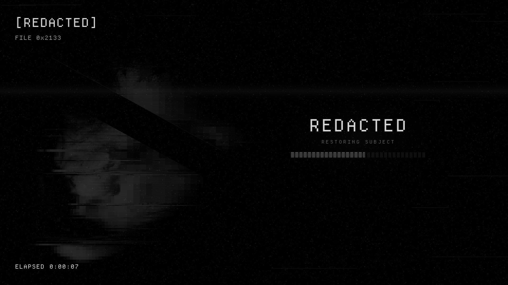
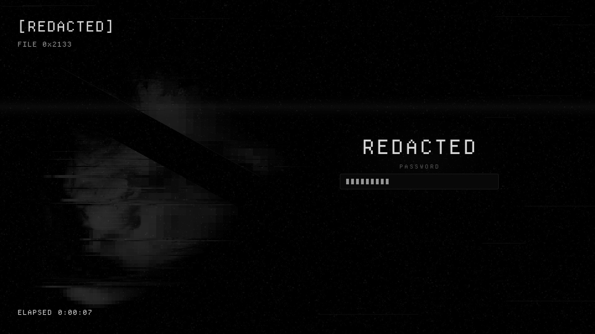
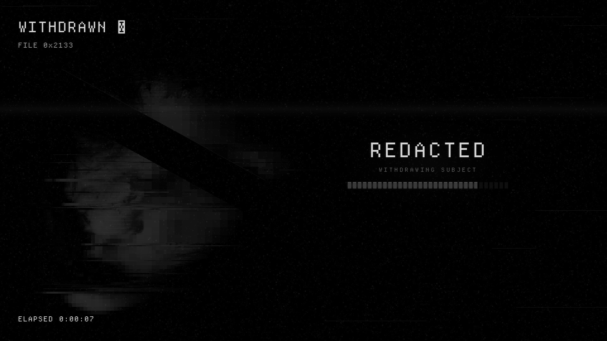

# Redacted — Plymouth Boot Splash

A boot splash of the censored face under live static, with censor-block progress and a redacted disk-unlock prompt.



Redacted is a monochrome-black look for KDE Plasma 6 about obfuscation and censorship. Every colour is a neutral grey, and the accents sit only a few levels above black: almost imperceptible, but just perceptible. The motifs are static, mosaic pixelation, black censor bars and a dissociated double.

## Features

- The face behind a censor bar, live static, and a tracking band that rolls down the screen.
- A `[REDACTED]` header with a file number, and an elapsed-time counter that ticks every second.
- Boot progress fills a strip of censor blocks under **REDACTED**.
- Separate shutdown and reboot captions.
- A disk-unlock prompt (LUKS) with censor-block bullets.
- Every word is pre-rendered, so the initramfs needs no fonts. Scales by screen height.





## Requirements

Plymouth with the `script` plugin (standard).

## Install

```bash
git clone https://github.com/numbpill3d/redacted-plymouth
cd redacted-plymouth && sudo ./install.sh
```

Or from the KDE Store: Extract it to `/usr/share/plymouth/themes/`, then run `sudo plymouth-set-default-theme -R redacted` (on dracut systems: `sudo plymouth-set-default-theme redacted && sudo dracut -f`).

## Configuration

Make sure `splash` is on the kernel command line.

## The rest of the suite

| piece | repo |
|---|---|
| Global theme + splash screen | [redacted-global](https://github.com/numbpill3d/redacted-global) |
| Plasma style (panel, popups) | [redacted-plasma](https://github.com/numbpill3d/redacted-plasma) |
| Aurorae window decoration | [redacted-aurorae](https://github.com/numbpill3d/redacted-aurorae) |
| Colour scheme | [redacted-colors](https://github.com/numbpill3d/redacted-colors) |
| Kvantum widget style | [redacted-kvantum](https://github.com/numbpill3d/redacted-kvantum) |
| Icon theme | [redacted-icons](https://github.com/numbpill3d/redacted-icons) |
| Konsole + kitty colours | [redacted-konsole](https://github.com/numbpill3d/redacted-konsole) |
| SDDM login | [redacted-sddm](https://github.com/numbpill3d/redacted-sddm) |
| Animated wallpaper (desktop + lock) | [redacted-wallpaper](https://github.com/numbpill3d/redacted-wallpaper) |
| Still wallpaper (1080p–4K) | [redacted-image-wallpaper](https://github.com/numbpill3d/redacted-image-wallpaper) |
| KWin open/close effect | [redacted-censor](https://github.com/numbpill3d/redacted-censor) |
| KWin script: active window under review | [redacted-static](https://github.com/numbpill3d/redacted-static) |
| Clock plasmoid | [redacted-clock](https://github.com/numbpill3d/redacted-clock) |

Everything at once, with the generators: [redacted-kde](https://github.com/numbpill3d/redacted-kde).

## Tags

`redacted` `kde` `plasma6` `dark` `black` `monochrome` `grayscale` `minimal` `censored` `glitch` `static` `pixel` `plymouth` `plymouth-theme` `boot-splash` `bootscreen` `luks`

## Credits and licence

By splicer scorn (voidrane). GPL-3.0-or-later.
